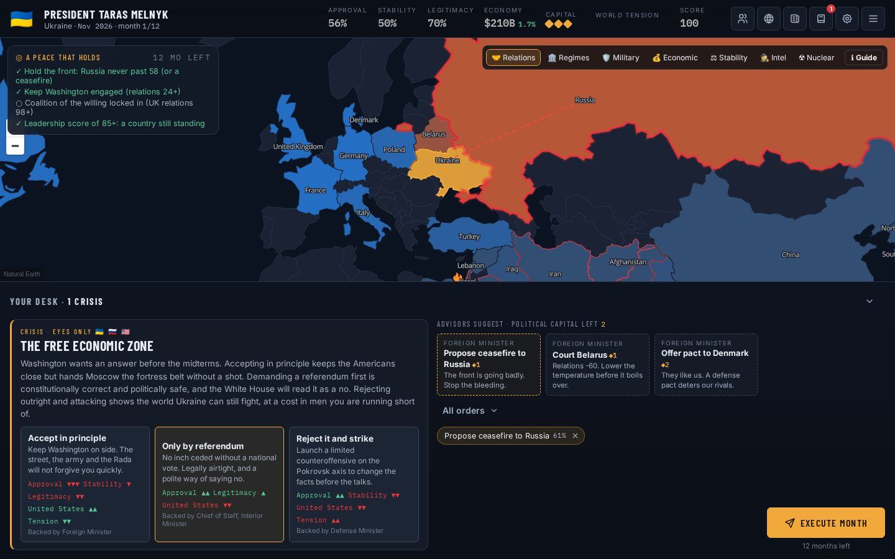
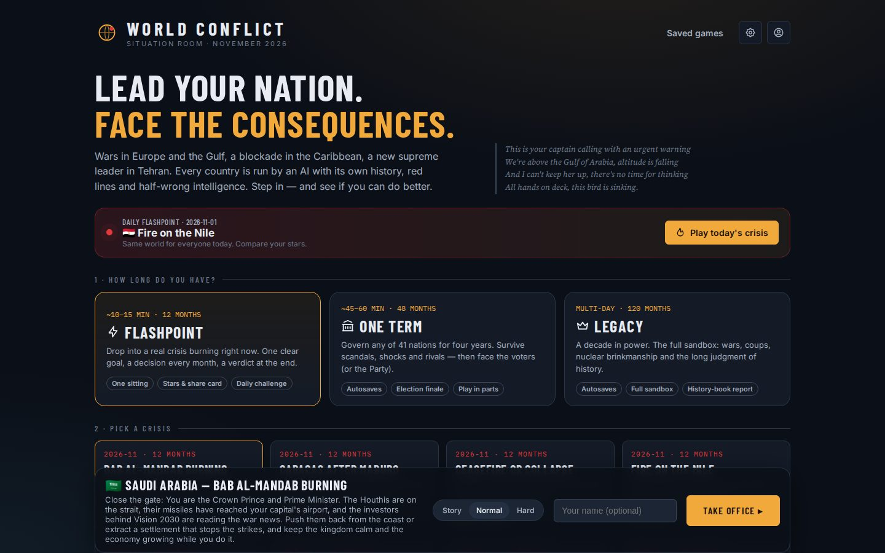
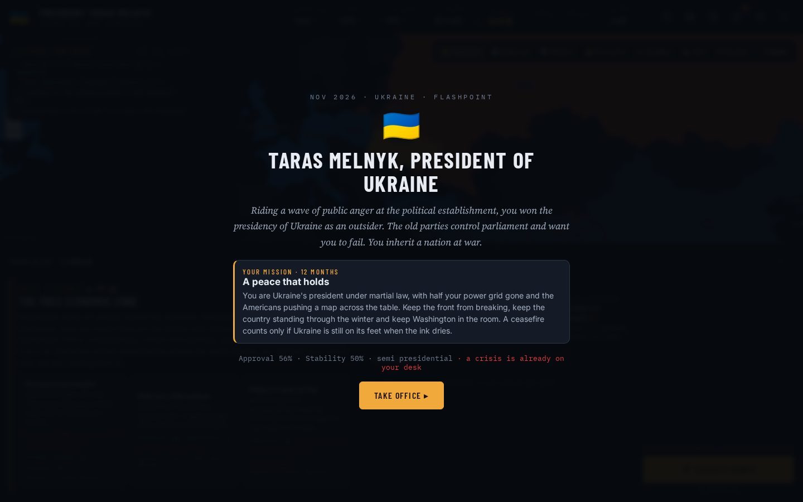
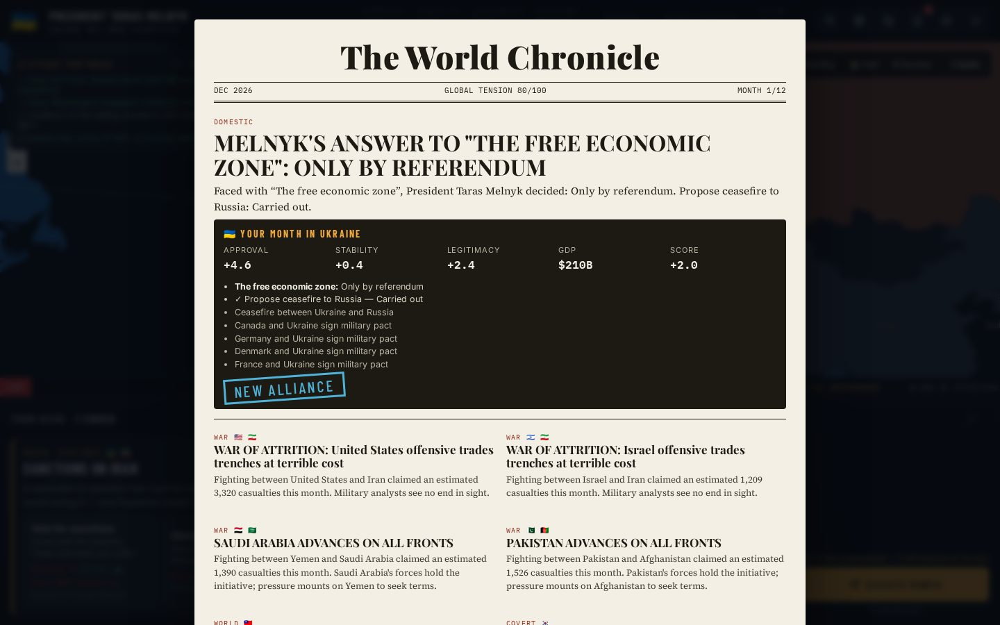
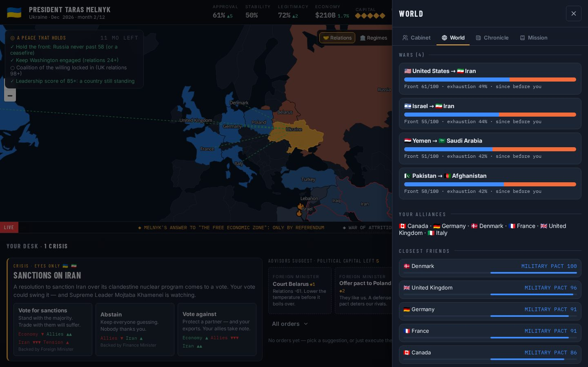
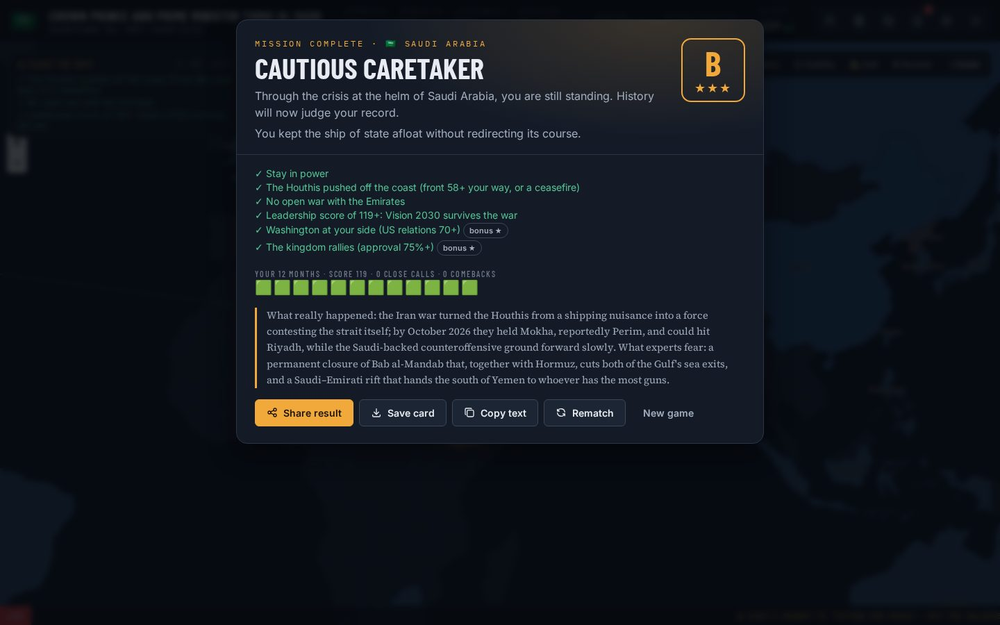
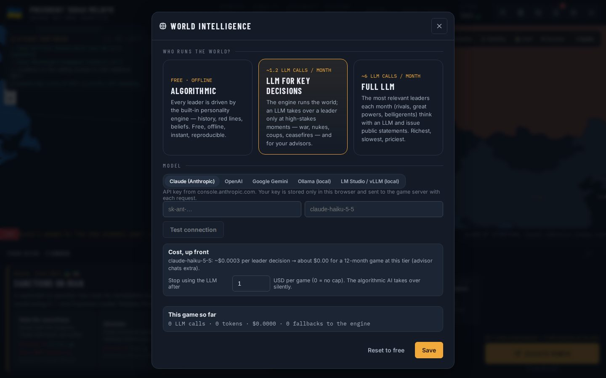
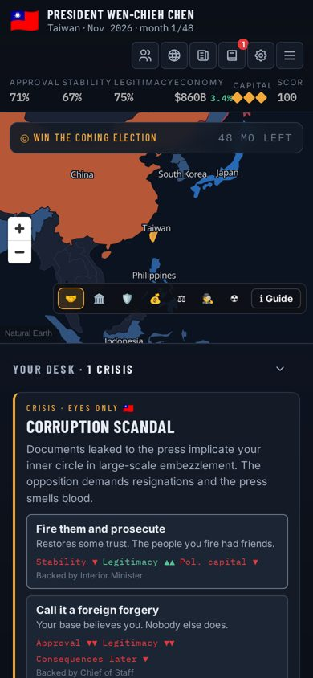

<div align="center">


# WORLD CONFLICT

### Lead your nation through the crises of 2026. Survive the coup plots, the ultimatums — and the bomb.

**A geopolitical strategy game where every country thinks for itself — and nobody, including you, sees the whole truth.**


*"This is your captain calling with an urgent warning —*
*we're above the Gulf of Arabia, altitude is falling."*



</div>

---

## 🎮 What is it?

**World Conflict** is a turn-based political–military simulation inspired by the 1990 classic *Conflict: Middle East Political Simulator* — rebuilt for the world of **November 2026**: war in Ukraine, a US–Israeli war with a new supreme leader in Tehran, a Caribbean blockade after Maduro's capture, the Houthis contesting Bab al-Mandab, a Taiwan Strait on edge.

Pick a nation. Every other government is an agent with its own history, red lines, leadership style and **half-wrong intelligence** about you. Each month a crisis lands on your desk, your ministers disagree, and you decide. Then the world answers.

| | |
|---|---|
| ⏱ **Sessions that fit your day** | A 10–15 minute **Flashpoint** with one clear goal, a 45-minute **Term** that ends at the ballot box, or a multi-day **Legacy**. |
| 🎢 **Drama by design** | 30+ crisis cards grounded in real historical patterns, delayed consequences, shocks that test comfortable leaders, coup plots you can *see coming*. |
| 🌍 **The real world, today** | 41 nations with current leaders, active wars and fresh history up to Oct 2026 — plus a debrief of what really happened. |
| 🕵️ **Asymmetric information** | You see your spies' estimates, not the truth. So does everyone else. Miscalculation is a feature. |
| 🤖 **AI you control — and pay for knowingly** | Free algorithmic leaders, or let an LLM (Claude, OpenAI, Gemini, or a local model) take over key decisions. Cost shown up front and live. |

---

## 📸 A tour

<table>
<tr>
<td width="50%"><br/><b>Choose how long you have.</b> Flashpoint, Term or Legacy — with honest time labels, a daily challenge and difficulty per nation.</td>
<td width="50%"><br/><b>Take office.</b> How you came to power, and the one thing you must achieve.</td>
</tr>
<tr>
<td><br/><b>Read the consequences.</b> The World Chronicle leads with <i>your</i> decision, then shows what moved and why.</td>
<td><br/><b>Watch the fronts.</b> Wars, alliances, friends and enemies — as your intelligence services see them.</td>
</tr>
<tr>
<td><br/><b>Get your verdict.</b> Grade, stars, a month-by-month emoji strip to share — and what really happened.</td>
<td><br/><b>Decide who runs the world.</b> Algorithmic, LLM for key decisions, or full LLM — with a spending cap.</td>
</tr>
</table>

<p align="center"><br/><i>Plays on a phone, too.</i></p>

---

## 🕹 Three ways to play

| Mode | Length | Goal | Best for |
|---|---|---|---|
| ⚡ **Flashpoint** | ~10–15 min · 12 months | A crisis-specific objective (hold the front, stop the bomb, keep the strait open) — 1 to 3 stars | A coffee break, the **daily challenge**, current-events what-ifs |
| 🗳 **One Term** | ~45–60 min · 48 months | Win the election at the end — or survive the inner circle's review in an autocracy | An evening; play in parts (autosave) |
| 👑 **Legacy** | multi-day · 120 months | Survive a decade; history grades your record | Grand-strategy players |

**Flashpoints (Nov 2026):** Ukraine's winter ceasefire · Hormuz convoy · Taiwan quarantine · Caracas after Maduro · Bab al-Mandab · Scarborough Shoal · India–Pakistan water war · Sudan's El Obeid.

---

## 🤖 AI tiers

| Tier | Who decides for the world's leaders | Cost |
|---|---|---|
| **Algorithmic** (default) | The built-in *PersonalityAI*: personality, history, red lines, regime constraints, beliefs | Free · offline · reproducible |
| **LLM for key decisions** | The engine runs the world; an LLM takes over a leader at high-stakes moments (war, nukes, coups, ceasefires) and voices your advisors | ~1 LLM call / month — fractions of a cent per game on small models |
| **Full LLM** | The most relevant leaders think with an LLM every month and issue public statements | ~6 calls / month |

Providers: **Claude** (Haiku 5.5 default), **OpenAI**, **Gemini**, **Ollama** or any **OpenAI-compatible local server** (LM Studio, vLLM). LLM output is only ever a *proposal*: the deterministic engine validates and resolves it, and falls back to the algorithmic AI on errors, timeouts or when your budget cap is reached.

---

## 🚀 Quick start

```bash
# Node.js ≥ 20.19 (22 LTS recommended)
npm install && (cd ui && npm install)
npx prisma db push          # creates the local SQLite save database
npm run dev                 # API on :8080, game on http://localhost:5173
```

No API key needed. To use an LLM, open **⚙ Settings** in the game, or see the **[Setup guide](docs/SETUP.md)**.

---

## 📚 Documentation

| | |
|---|---|
| **[Setup guide](docs/SETUP.md)** | Install, run, configure LLMs, troubleshoot |
| **[Game guide](docs/GAMEPLAY.md)** | Modes, the desk, crises, political capital, scoring, tips |
| **[Architecture](docs/ARCHITECTURE.md)** | Engine, turn pipeline, AI tiers, data model — with diagrams |
| **[API reference](docs/API.md)** | REST endpoints |
| **[Development guide](docs/DEVELOPMENT.md)** | Code layout, testing, the playtest harness, contributing |
| **[Project status](dev_plan/project_status.html)** | Live development plan, tasks, decisions |

---

## 🎲 Design principles

1. **Plausible, not prophetic.** Countries act on their real history and interests; outcomes are alternate histories you could believe.
2. **Nobody sees everything.** Intelligence is imperfect — for you and for every AI.
3. **Every month asks something of you.** No dead turns; consequences arrive late and in public.
4. **Almost lost, then won.** Telegraphed threats, comebacks and shocks are tuned with a headless playtest harness.
5. **AI-enhanced, never AI-dependent.** The game is complete and free without any LLM.

<div align="center">

**The world is waiting. Take office.**

</div>
