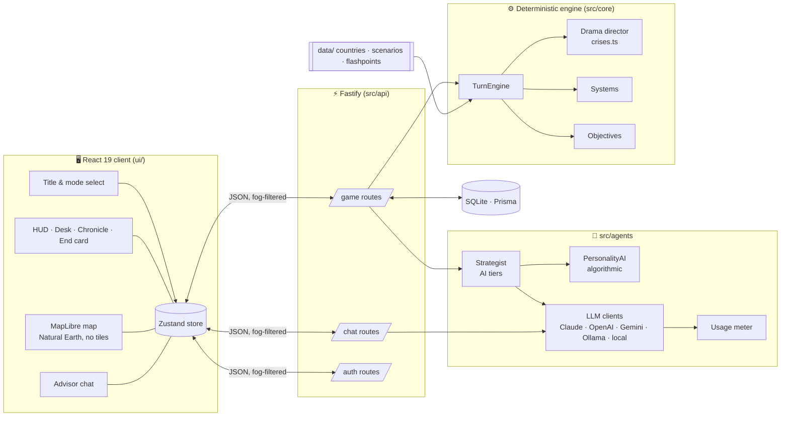
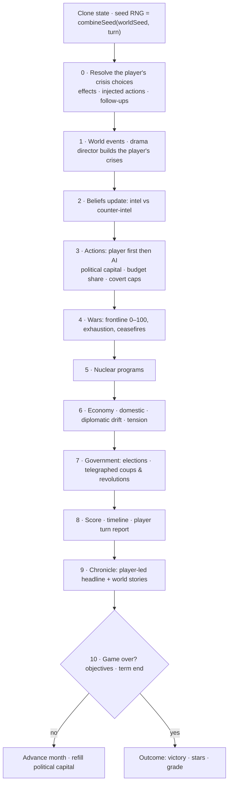
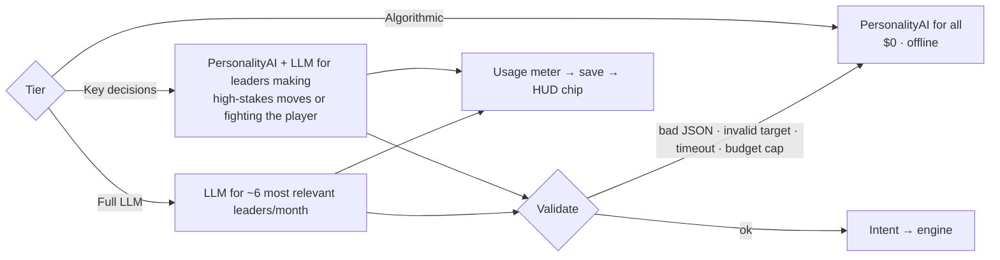

# 🏗 Architecture

World Conflict is three layers around one rule: **the deterministic engine is the only source of truth.** AIs (algorithmic or LLM) only *propose*; the engine resolves.

---

## The turn pipeline

`TurnEngine.executeTurn(state, playerActions, aiIntents, decisionChoices)` clones the state and runs:

**Determinism:** same seed + same intents ⇒ identical world. All randomness flows through `SeededRandom`. LLM output is non-deterministic, so LLM intents are inputs to the engine (like player actions) and are logged per turn (`TurnLog`).

---

## Modules

| Area | Path | Responsibility |
|---|---|---|
| Types | `src/core/types.ts` | Zod schemas: country, world, modes, objectives, crises, turn report |
| Turn engine | `src/core/turn.ts` | Pipeline above; orders, decisions, tension, game over |
| Drama director | `src/core/crises.ts` | ~30 player-facing crisis templates, follow-ups, shocks, cadence per mode, telegraphed coups |
| World events | `src/core/events.ts` | AI-world events (border incidents, oil shocks, leaks, summits) |
| Costs | `src/core/costs.ts` | Political capital & budget-share costs |
| Objectives | `src/core/objectives.ts` | Conditions, early failure, stars |
| Systems | `src/core/systems/*` | military, diplomacy, covert, nuclear, economy, stability, intelligence, government |
| Data loader | `src/core/data-loader.ts` | Scenarios, flashpoints, modes, cold-open crisis |
| Preview | `src/core/preview.ts` | Predicts an order's effects/odds without mutating state |
| Country AI | `src/agents/fallback.ts` | `PersonalityAI` — deterministic leaders |
| AI tiers | `src/agents/strategist.ts` | Picks countries for LLM leadership, validates, falls back |
| LLM | `src/agents/llmClient.ts`, `providers/anthropic.ts` | Provider clients |
| Usage | `src/agents/usage.ts` | Price table, per-call metering, session totals |
| API | `src/api/routes/*` | game, chat, auth; fog-of-war payload |
| Store | `ui/src/store/gameStore.ts` | Client state, API calls, settings, saves |
| Screens | `ui/src/components/*` | TitleScreen, Hud, Desk, Chronicle, EndScreen, Drawers, MapView, SettingsModal… |

---

## AI tiers

Validation: JSON parse → `ActionSchema` → allowed action types → no self-targets or dead countries → max 3 actions. The LLM sees **only its own country's beliefs**, never ground truth.

---

## Information model

| Field | Player sees | AI sees |
|---|---|---|
| Own country | everything | everything |
| Foreign GDP, stability, military, nuclear progress | belief estimate with confidence range | its own beliefs |
| Foreign personality, red lines (private), beliefs | hidden | hidden |
| Leaders, regimes, alliances, wars | public | public |

`publicWorldState()` in `src/api/routes/game.ts` strips foreign ground truth before anything reaches the browser.

---

## Data

| Folder | Content | Schema |
|---|---|---|
| `data/countries/*.json` | 41 country profiles: political system, history to 2026, personality, red lines, internal divisions, economy, military | `CountryProfileSchema` |
| `data/scenarios/*.json` | 1960 · 1990 · 2025 · **2026**: leaders, overrides, relations, blocs, wars, deployments, briefing | `ScenarioSchema` |
| `data/flashpoints/*.json` | 8 short authored crises: playable sides, setup, objectives, scripted crises, debrief | `FlashpointSchema` |

---

## Persistence

`SaveGame` stores the full world as JSON (re-validated on load), the owner (account or guest id) and cumulative `llmUsage`. Each month autosaves; `TurnLog` keeps events and the AI intents used.
