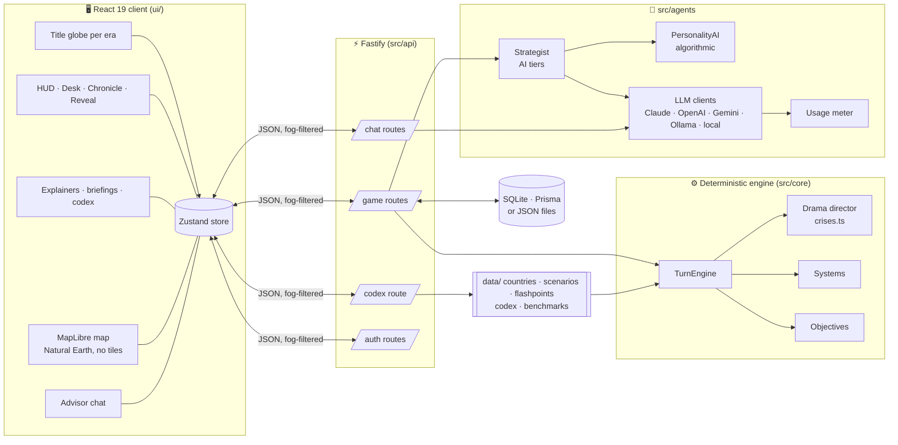
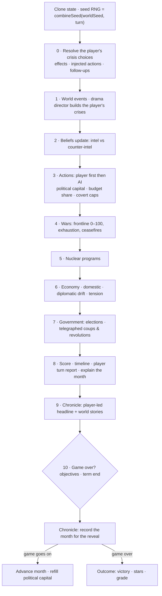
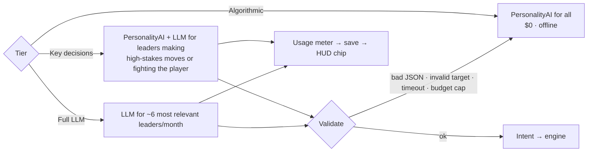

# 🏗 Architecture

World Conflict is three layers around one rule: **the deterministic engine is the only source of truth.** AIs (algorithmic or LLM) only *propose*; the engine resolves.

---

## The turn pipeline

`TurnEngine.executeTurn(state, playerActions, aiIntents, decisionChoices)` clones the state and runs:

Around the engine, `src/api/routes/game.ts` adds the month's advice to every payload (`buildAdvice` in `advisors.ts`, `missionImpact.ts`), and at the end of a session builds the reveal from the finished world and its chronicle (`reveal.ts`).

**Determinism:** same seed + same intents ⇒ identical world. All randomness flows through `SeededRandom`. LLM output is non-deterministic, so LLM intents are inputs to the engine (like player actions) and are logged per turn (`TurnLog`).

---

## Modules

| Area | Path | Responsibility |
|---|---|---|
| Types | `src/core/types.ts` | Zod schemas: country, world, modes, objectives, crises, turn report |
| Turn engine | `src/core/turn.ts` | Pipeline above; orders, decisions, tension, game over |
| Drama director | `src/core/crises.ts` | ~30 player-facing crisis templates, follow-ups, shocks, cadence per mode, telegraphed coups |
| Calendar | `src/core/meetings.ts` | Calls, staff meetings, state visits and interviews each month (own seeded stream) |
| World events | `src/core/events.ts` | AI-world events (border incidents, oil shocks, leaks, summits) |
| Geography | `src/core/geography.ts` | Land borders and landlocked states (neighbour crises, refugee flows, naval vs air incidents) |
| Costs | `src/core/costs.ts` | Political capital & budget-share costs |
| Objectives | `src/core/objectives.ts` | Conditions, early failure, stars |
| Orders | `src/core/orders.ts`, `availability.ts` | The order list as data; why an order can or can't be given (reason code, one line of copy, a fix, an alternative), shared by the orders menu, preview and Execute |
| Advisors | `src/core/advisors.ts`, `missionImpact.ts` | Staff suggestions, cabinet pick vs mission pick, meeting answers, staff orders; which objectives an option or order helps, hurts or breaks |
| Explaining the month | `src/core/explain.ts`, `outcomes.ts`, `reactions.ts`, `scoring.ts` | Choices vs drift, follow-ups, the step objective, order dispatches, reaction lines without repeats, the terms behind each score part |
| Outcome status | `src/core/status.ts`, UI `ui/src/lib/outcome.ts` | One status per resolved item (DONE, PARTLY, FAILED, REFUSED, NO_EFFECT) with a reason, on every order, decision and foreign move in the turn report; `report.yourMove` is the player's own move. The UI renders it and never infers a status from the numbers |
| Chronicle | `src/core/chronicle.ts` | One sample and up to 6 moments per month, recorded for the reveal |
| Reveal | `src/core/reveal.ts`, `reveal-text.ts`, `achievements.ts` | End-of-session payload: Presidency Score, achievements, moments, perception, declassified truth, real-history table, ranking, replay |
| Era | `src/core/era.ts`, `era-map.ts` | Which nations are states in the scenario's year (era filter); the title globe's era map |
| Codex | `src/core/codex.ts` | Schemas and date/era filters for the codex and situation briefings (no I/O, not part of `WorldState`) |
| Systems | `src/core/systems/*` | military, diplomacy, covert, nuclear, economy, stability, intelligence, government |
| Data loader | `src/core/data-loader.ts` | Scenarios, flashpoints, modes, cold-open crisis |
| Preview | `src/core/preview.ts` | Predicts an order's effects/odds without mutating state |
| Country AI | `src/agents/fallback.ts` | `PersonalityAI`: deterministic leaders |
| AI tiers | `src/agents/strategist.ts` | Picks countries for LLM leadership, validates, falls back |
| LLM | `src/agents/llmClient.ts`, `providers/anthropic.ts` | Provider clients |
| Usage | `src/agents/usage.ts` | Price table, per-call metering, session totals |
| API | `src/api/routes/*` | game, codex, chat, auth; fog-of-war payload |
| Benchmarks | `src/infra/benchmarks.ts`, `scripts/benchmark.ts` | Benchmark files for the ranking ladder and achievement rarity, with a fingerprint of the code they depend on |
| Store | `ui/src/store/gameStore.ts` | Client state, API calls, settings, saves |
| Screens | `ui/src/components/*` | TitleScreen (+ TitleGlobe, `globe/`), Hud, Desk (`desk/`), Chronicle, EndScreen (`reveal/`), Drawers, MapView, SettingsModal… |
| Orders UI | `ui/src/components/orders/*` | One OrderCard (desk, map menu, dossier), order catalog, confirm face, country picker |
| Learning aids | `ui/src/components/learn/*`, `ui/src/lib/learn.ts`, `codexMatch.ts` | Explainers, situation briefings, the codex drawer, familiarity levels; progress kept in the browser |

---

## AI tiers

Validation: JSON parse → `ActionSchema` → allowed action types → no self-targets or dead countries → max 3 actions. The LLM sees **only its own country's beliefs**, never ground truth.

---

## Information model

| Field | Player sees | AI sees |
|---|---|---|
| Own country | everything | everything |
| Foreign GDP, stability, military, nuclear progress | belief estimate with confidence range | its own beliefs |
| Foreign personality, red lines (private), beliefs | hidden | hidden |
| After the game: real nuclear progress, real strength of the main rival, covert operations run against you | `declassified` in the reveal | - |
| Leaders, regimes, alliances, wars | public | public |

`publicWorldState()` in `src/api/routes/game.ts` strips foreign ground truth before anything reaches the browser, including the chronicle's ground-truth parts while the game runs. The reveal (`GET /api/reveal/:saveId`, 409 until the game is over) is the only place it crosses, once.

---

## Data

| Folder | Content | Schema |
|---|---|---|
| `data/countries/*.json` | 41 country profiles: political system, history to 2026, personality, red lines, internal divisions, economy, military | `CountryProfileSchema` |
| `data/scenarios/*.json` | 1960 · 1990 · 2025 · **2026**: leaders, overrides, relations, blocs, wars, deployments, briefing | `ScenarioSchema` |
| `data/flashpoints/*.json` | 8 short authored crises: playable sides, setup, objectives, scripted crises, debrief, per-side `reality` rows (the reveal's real-history table) and a signature achievement | `FlashpointSchema` |
| `data/codex/*.json`, `data/codex/situations/*.json` | About 560 real-world entries (people, places, groups, terms, events) and 12 situation briefings (one per flashpoint and per scenario) | `src/core/codex.ts` |
| `data/benchmarks/*.json` | Generated by `npm run bench:reveal`: score quantiles per seat and policy, achievement rarity per mode | `SeatBenchmark`, `AchievementRarity` in `reveal.ts` |
| `ui/public/era/shapes.geojson` | Borders that no longer exist (East Germany, South Yemen), drawn on the title globe | - |

Scenarios can carry optional era map fields (`situations`, `blocs`, `eraStatus`, `merged`, `mapFocus`, `mapLabels`, `labelAllow`, validated by `EraMapFieldsSchema` in `data-loader.ts`). The engine reads only `eraStatus` and `blocs` (the era filter); the rest is display data for `GET /api/scenarios/:id/map`.

---

## Persistence

`SaveGame` stores the full world as JSON (re-validated on load), the owner (account or guest id) and cumulative `llmUsage`. Each month autosaves; `TurnLog` keeps events and the AI intents used. `RunResult` keeps one finished run per save for the run history and ranking (with the JSON store: `saves/runs.json`). The SQLite store is optional: without it, saves are JSON files in `saves/` (`src/infra/db.ts`).

The codex is static content served by its own route, never stored in a save. The client keeps learning progress (familiarity level, names already met and opened) and its own run history in `localStorage`.

---

## Module reference by layer

Detail moved from `CLAUDE.md` so that file stays short. The Modules table above lists the files; this section says what each part does and which rules it carries.

### Core (`src/core/`)

Pure simulation engine, no I/O, no LLM calls. `TurnEngine.executeTurn(state, playerActions, aiIntents, decisionChoices)` clones the state (`structuredClone`) and runs these phases: resolve crisis decisions (effects, injected actions, follow-ups), world events (`events.ts`, AI-world only) plus the drama director (`crises.ts`: ~30 player crisis templates, shocks, follow-ups, per-mode cadence, cooldowns), belief updates, action resolution (player orders cost political capital / budget share, `costs.ts`), wars, nuclear, economy/domestic/diplomatic drift/tension, government dynamics (elections; coups and revolutions are telegraphed to the player as crises first), scoring + player turn report, newspaper (player-led headline), game over (`objectives.ts`: conditions, early failure, stars).

- Domain subsystems live in `src/core/systems/`. `hotspots.ts` models Gaza and the West Bank as hot zones that are not states, seeded per scenario and moved by `hot:<ID>:<metric>` crisis effects.
- `preview.ts` predicts action consequences without mutating state.
- `outcomes.ts` turns each player order into a dispatch (before/after facts, varied deterministic narration, failure stories) and keeps `director.ledger`, the headline number of each order type after every use.
- `orders.ts` is the player's order list as data. `availability.ts` decides whether an order can be given (rule layer: `OrderBlock {code, reason, fix, points, alt?}`); the UI adds the month layer in `ui/src/lib/availability.ts` with identical copy, and preview, `/orders/menu` and Execute share it.
- `chronicle.ts` `recordMonth` samples each month for the reveal.
- `reveal.ts` (+ `reveal-text.ts`, `achievements.ts`: 37 seals plus one signature per flashpoint side) builds the end-of-session payload: Presidency Score 0-1000, achievements with benchmark rarity, moments, perception, declassified truth, flashpoint `reality` table, ranking, seed codes (`HC-USA-3AF`, `T2026-USA-...`).
- `era.ts` is the era filter: countries `PART_OF` / `NOT_INDEPENDENT` in the scenario get no AI orders, pacts, events or crisis roles and cannot be targeted as states; they are led only with `whatIf`, and the player's own country is never marked. `opening.ts` builds the One Term "Start with" opening crisis from an era situation. `era-map.ts` builds the title globe's era map (display only).
- `replay.ts` rebuilds a save at any month from `world.origin` + `world.inputs` (recorded by `/turn`).
- `codex.ts` holds codex/situation schemas and date/era filters (no I/O, never in `WorldState`).
- `meetings.ts` builds the monthly calendar.
- `missionImpact.ts` says which objectives an option or order helps, hurts or breaks. `advisors.ts` (suggestions, cabinet pick vs mission pick, meeting picks, staff orders with variety rules) feeds the `advice` / `missionImpact` / `objectiveStatus` payload and the harness `staff` / `staffswitch` policies.
- `scoring.ts` `scoreBreakdown` names the terms behind each score part. `explain.ts` fills the report's drift, follow-ups, step objective and repeat marks. `reactions.ts` `freshLines` keeps reaction lines from repeating (`director.recentLines`).
- `types.ts` is the single source of truth for domain types, all Zod schemas. `CountryProfileSchema` validates the static JSON files in `data/countries/`; `CountryStateSchema` / `WorldStateSchema` are the runtime state. Scenario era-overrides (`leaders`, `countryOverrides`) are validated by `ScenarioSchema` in `data-loader.ts`. Simulated countries are `TIER1_COUNTRIES` in `types.ts`.
- `data-loader.ts` `newGame()` builds a session (mode, difficulty, flashpoint) and opens with a crisis.
- **Asymmetric information is real**: each country holds `beliefs` (noisy estimates of others' strength/GDP/stability/nuclear progress, accuracy driven by intel vs counter-intel). The AI decides from beliefs, not ground truth, and the API returns a belief-filtered `playerView` (with uncertainty ranges) for foreign countries.

### Agents (`src/agents/`)

- `fallback.ts`: `PersonalityAI`, the deterministic country AI: decisions weighted by personality traits, historical rivals/allies, red lines, leader style, regime constraints and beliefs.
- `strategist.ts` `planTurn(world, aiConfig)` is what `POST /api/turn` uses: it returns PersonalityAI intents, replacing selected countries' intents with validated LLM proposals per tier (fallback on any failure/timeout/budget cap).
- `usage.ts` meters tokens/cost (persisted per save in `SaveGame.llmUsage`).
- Providers: `llmClient.ts` (OpenAI, Gemini, Ollama, OpenAI-compatible `local`) and `providers/anthropic.ts` (official SDK).

### API (`src/api/`)

- `routes/game.ts` is stateless (loads from DB per request): `/new-game` (mode, difficulty, flashpointId, daily, seed, seedCode, whatIf, opening), `POST /branch` (saveId, month: a new save rebuilt from origin + inputs, `core/replay.ts`), `/turn` (`playerActions`, `decisions`, optional `ai` tier config), `/preview-action`, `/orders/menu` (every order for one target with cost, chance, block), `/report/:saveId`, `/reveal/:saveId` (409 while running), `POST` / `GET /runs` (run history, `RunResult` or `saves/runs.json`), `/scenarios` (+ flashpoints + daily), `/scenarios/:id/map` (era map), `/countries`, `/saves` (`?playerId=&guestId=`, both owners together), `/load/:saveId`, `DELETE /save/:saveId`.
- `routes/codex.ts`: `GET /codex?scenario=&flashpoint=` (ETag). Outside production it re-stamps `data/codex`, `scenarios` and `flashpoints` per request and drops caches when a file changed, so a running dev server serves fresh codex.
- Payloads pass through `publicWorldState()` (which also strips the chronicle's `start` / `plots`) so foreign ground truth never reaches the client; the reveal is the only post-game exception (`declassified`). Every payload carries `monthAdvice()` (`advice`, `missionImpact`, `orderImpact`, `objectiveStatus`) and `pcIncome` / `pcCap`.

### Infra (`src/infra/`)

- `db.ts`: two save stores behind `gameDb`: SQLite via Prisma + better-sqlite3 (optional dependencies, loaded lazily; `DATABASE_URL`, default `file:./dev.db`) and `JsonStore` (one JSON file per save in `saves/`), used when `DB_DRIVER=json` or when SQLite fails to load. World state is re-validated with `WorldStateSchema` on write and on load. `npm run setup` (`scripts/setup.mjs`, wrappers `setup.cmd` / `setup.sh`) installs and picks the store.
- `benchmarks.ts`: fingerprint of the code the benchmarks depend on (see the benchmark rule in `CLAUDE.md`; `npm run bench:reveal` regenerates `data/benchmarks/`).

### Frontend (`ui/`)

- `ui/src/store/gameStore.ts` (Zustand) holds the server payload (`worldState`, belief-filtered `playerView`, `pendingDecisions`, `objectiveStatus`, `score`, `gameOver`), screen (`title | game`), pending orders (with server previews), crisis choices, AI-tier settings (localStorage) and usage, and the guest id (saves without an account). **Types are duplicated, not shared**: `gameStore.ts` re-declares the backend types, so changing a backend schema means updating both.
- Scenes: `ui/src/scenes/` stages every order, crisis and story as one of 20 animated SVG broadcast scenes (`kinds.ts` maps action types, crisis templates and headlines to scenes; art in `scenes/art/`, contract in `art/STYLE.md`). After Execute (`Chronicle.tsx`): optional `BigMoment` (`lib/moments.ts`, at most one a month) then `scenes/ResultCard.tsx`, then optional details (`MonthDebrief`, pages of `OutcomeCard`s grouped by `lib/debrief.ts`; reactions and facts come from the engine), then the paper, per the "After each month" setting. `#scenes`, `#clip`, `#mapfx`, `#moments` are dev gallery routes.
- Orders: one `components/orders/OrderCard` on desk (`OrderCatalog`), map menu (`MapActionMenu`) and dossier (`CountryDetailPanel`), with `ConfirmFace` (declare war, nuclear strike, mission warnings), `CountryPicker`, and `lib/pointAt.ts` lighting the `[data-point]` element a reason is about; all queue through `queueOrder()`.
- Player-facing words come from `lib/glossary.ts` (`tests/ui-glossary.spec.ts` bans synonyms in UI strings, objective labels and docs/GAMEPLAY.md). The UI renders outcome status via `ui/src/lib/outcome.ts` and never infers one from facts.
- Month: `desk/YourMove`; `desk/GoalLine` (under the HUD, opens the Mission sheet; month 1 adds `MissionLine`, the goal in one sentence above the crisis, from `lib/goals.ts` `missionSentence`); `desk/AdvisorList` (desk, full desk and map strip; each suggestion is the shared `OrderCard` row; why lines and Big move from `lib/ease.ts`); `desk/Coach`.
- Staff propose up to 2 orders (`lib/month.ts`): a `PendingAction` with `proposed: true` holds no political capital, order slot or defense money until approved (`approveProposal()`, Approve all), and Execute sends only `committedActions()`; the harness `staff` policy is Approve all.
- Every Accept all control lives inside `desk/StaffPicks` (RS-005; words D-72, one verb "Accept": rail, phone plan sheet, map strip): the group titled "Recommended" from `lib/month.ts` `staffPickItems()` (crisis answers, proposals, meetings, deputies, each "Recommended by <adviser>" with Accept and Change) and the main button "Accept all recommended (n)" whose count is that list; in Map mode it starts folded as "Review n recommended", which only opens the list. The map menu closes when the desk takes over (`lib/ease.ts` `mapMenuShown`).
- Sound: WebAudio synth in `lib/sound.ts`. Reveal: `EndScreen` then `reveal/RevealSequence` (8 stages in `reveal/model.ts`), share cards in `lib/shareCard.ts`, local run history in `lib/runs.ts`.
- Learning aids: `components/learn/*` (Explainer, SituationBriefing, BriefingPanel, Codex drawer, FamiliarityPrompt), levels Guide me / Some help / I know this (`lib/codexMatch.ts` `LEVEL_RULES`; Guide me also shortens the crisis text before More, `lib/month.ts` `guideLede`), progress in `localStorage` (`lib/learn.ts`). The situation briefing never opens by itself unless the Settings toggle is on (`autoBriefOn`, off by default at every level).
- Screens: `TitleScreen` (the globe is the menu: `TitleGlobe` pins every flashpoint, or in Term/Legacy shows the era's world from `/scenarios/:id/map` with time travel between eras, `globe/` layers and `EraCard`; a dossier picks the side, era and nation; `reveal/YourRecord` and Play this seed), `Hud` (with the Map/Desk switch and ticker toggle), `Desk` (Desk mode: `desk/Navigator`, `desk/Detail`, `desk/CommandRail` with budgets, selection, readiness, Accept all recommended and Execute; `CommandStrip` in Map mode; staff defaults in `lib/month.ts` and `lib/staff.ts`, budgets in `lib/budget.ts`, the 2D subject map in `scenes/ContextMap.tsx`), `Chronicle` (post-turn newspaper + "your month"), `EndScreen` (grade, stars, emoji grid, share card), `Drawers` (cabinet/world/chronicle/mission), `SettingsModal` (AI tiers, cost).
- The map (`MapView.tsx`) draws Natural Earth polygons (`ui/public/world.geojson`, `ADM0_A3`) on a tileless ocean with a colorblind-safe Relations default layer. Design tokens live in `ui/src/styles/wc.css`.

### Game data details

- Country codes are Natural Earth codes; West Bank = `PSX`. Scenarios (`1960`, `1990`, `2025`, `2026`) carry era-accurate leaders, overrides, relations, blocs, starting wars, deployments and briefing lines; leaders keep their real `sinceDate` from the era file.
- Scenario era map fields (`EraMapFieldsSchema`: `eraStatus`, `blocs`, `situations`, `merged`, `mapFocus`, `mapLabels`, `labelAllow`): the engine reads only `eraStatus` and `blocs`.
- `data/codex/*.json` (~560 entries) and `data/codex/situations/` (one per flashpoint and `scenario-<id>`), schema in `src/core/codex.ts`, checked by `tests/codex/schema.spec.ts`. `data/benchmarks/` is generated.
- Era filter data: 1960 has UKR, BLR, SYR, ARE, PSX, NGA with `eraStatus` until 1960-10; 1990 has UKR, BLR; 2025/2026 have none (PSX plays and acts as in v0.9.0).
