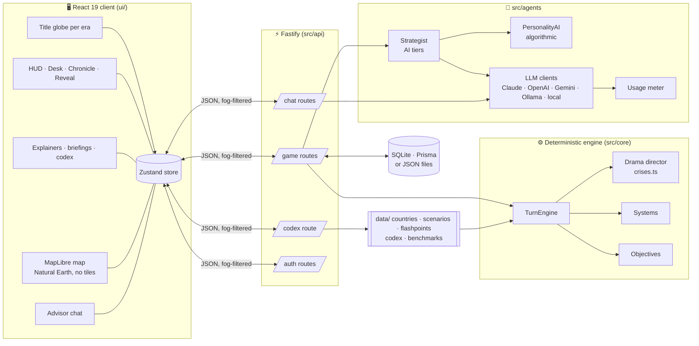
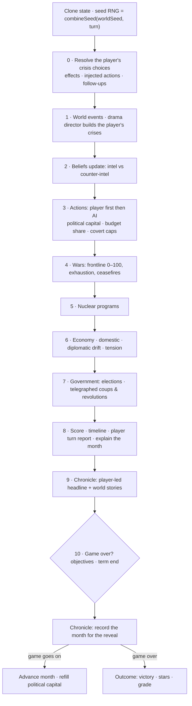
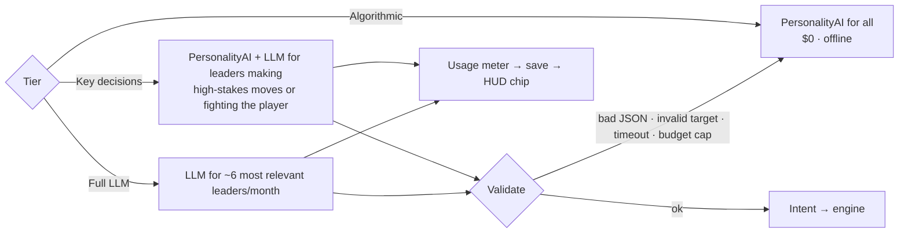

# 🏗 Architecture

World Conflict is three layers around one rule: **the deterministic engine is the only source of truth.** AIs (algorithmic or LLM) only *propose*; the engine resolves.

---

## The turn pipeline

`TurnEngine.executeTurn(state, playerActions, aiIntents, decisionChoices)` clones the state and runs:

Around the engine, `src/api/routes/game.ts` adds the month's advice to every payload (`buildAdvice` in `advisors.ts`, `missionImpact.ts`), and at the end of a session builds the reveal from the finished world and its chronicle (`reveal.ts`).

**Determinism:** same seed + same intents ⇒ identical world. All randomness flows through `SeededRandom`. LLM output is non-deterministic, so LLM intents are inputs to the engine (like player actions) and are logged per turn (`TurnLog`).

---

## Modules

| Area | Path | Responsibility |
|---|---|---|
| Types | `src/core/types.ts` | Zod schemas: country, world, modes, objectives, crises, turn report |
| Turn engine | `src/core/turn.ts` | Pipeline above; orders, decisions, tension, game over |
| Drama director | `src/core/crises.ts` | ~30 player-facing crisis templates, follow-ups, shocks, cadence per mode, telegraphed coups |
| Calendar | `src/core/meetings.ts` | Calls, staff meetings, state visits and interviews each month (own seeded stream) |
| World events | `src/core/events.ts` | AI-world events (border incidents, oil shocks, leaks, summits) |
| Geography | `src/core/geography.ts` | Land borders and landlocked states (neighbour crises, refugee flows, naval vs air incidents) |
| Costs | `src/core/costs.ts` | Political capital & budget-share costs |
| Objectives | `src/core/objectives.ts` | Conditions, early failure, stars |
| Orders | `src/core/orders.ts`, `availability.ts` | The order list as data; why an order can or can't be given (reason code, one line of copy, a fix, an alternative), shared by the orders menu, preview and Execute |
| Advisors | `src/core/advisors.ts`, `missionImpact.ts` | Staff suggestions, cabinet pick vs mission pick, meeting answers, staff orders; which objectives an option or order helps, hurts or breaks |
| Explaining the month | `src/core/explain.ts`, `outcomes.ts`, `reactions.ts`, `scoring.ts` | Choices vs drift, follow-ups, the step objective, order dispatches, reaction lines without repeats, the terms behind each score part |
| Chronicle | `src/core/chronicle.ts` | One sample and up to 6 moments per month, recorded for the reveal |
| Reveal | `src/core/reveal.ts`, `reveal-text.ts`, `achievements.ts` | End-of-session payload: Presidency Score, achievements, moments, perception, declassified truth, real-history table, ranking, replay |
| Era | `src/core/era.ts`, `era-map.ts` | Which nations are states in the scenario's year (era filter); the title globe's era map |
| Codex | `src/core/codex.ts` | Schemas and date/era filters for the codex and situation briefings (no I/O, not part of `WorldState`) |
| Systems | `src/core/systems/*` | military, diplomacy, covert, nuclear, economy, stability, intelligence, government |
| Data loader | `src/core/data-loader.ts` | Scenarios, flashpoints, modes, cold-open crisis |
| Preview | `src/core/preview.ts` | Predicts an order's effects/odds without mutating state |
| Country AI | `src/agents/fallback.ts` | `PersonalityAI`: deterministic leaders |
| AI tiers | `src/agents/strategist.ts` | Picks countries for LLM leadership, validates, falls back |
| LLM | `src/agents/llmClient.ts`, `providers/anthropic.ts` | Provider clients |
| Usage | `src/agents/usage.ts` | Price table, per-call metering, session totals |
| API | `src/api/routes/*` | game, codex, chat, auth; fog-of-war payload |
| Benchmarks | `src/infra/benchmarks.ts`, `scripts/benchmark.ts` | Benchmark files for the ranking ladder and achievement rarity, with a fingerprint of the code they depend on |
| Store | `ui/src/store/gameStore.ts` | Client state, API calls, settings, saves |
| Screens | `ui/src/components/*` | TitleScreen (+ TitleGlobe, `globe/`), Hud, Desk (`desk/`), Chronicle, EndScreen (`reveal/`), Drawers, MapView, SettingsModal… |
| Orders UI | `ui/src/components/orders/*` | One OrderCard (desk, map menu, dossier), order catalog, confirm face, country picker |
| Learning aids | `ui/src/components/learn/*`, `ui/src/lib/learn.ts`, `codexMatch.ts` | Explainers, situation briefings, the codex drawer, familiarity levels; progress kept in the browser |

---

## AI tiers

Validation: JSON parse → `ActionSchema` → allowed action types → no self-targets or dead countries → max 3 actions. The LLM sees **only its own country's beliefs**, never ground truth.

---

## Information model

| Field | Player sees | AI sees |
|---|---|---|
| Own country | everything | everything |
| Foreign GDP, stability, military, nuclear progress | belief estimate with confidence range | its own beliefs |
| Foreign personality, red lines (private), beliefs | hidden | hidden |
| After the game: real nuclear progress, real strength of the main rival, covert operations run against you | `declassified` in the reveal | - |
| Leaders, regimes, alliances, wars | public | public |

`publicWorldState()` in `src/api/routes/game.ts` strips foreign ground truth before anything reaches the browser, including the chronicle's ground-truth parts while the game runs. The reveal (`GET /api/reveal/:saveId`, 409 until the game is over) is the only place it crosses, once.

---

## Data

| Folder | Content | Schema |
|---|---|---|
| `data/countries/*.json` | 41 country profiles: political system, history to 2026, personality, red lines, internal divisions, economy, military | `CountryProfileSchema` |
| `data/scenarios/*.json` | 1960 · 1990 · 2025 · **2026**: leaders, overrides, relations, blocs, wars, deployments, briefing | `ScenarioSchema` |
| `data/flashpoints/*.json` | 8 short authored crises: playable sides, setup, objectives, scripted crises, debrief, per-side `reality` rows (the reveal's real-history table) and a signature achievement | `FlashpointSchema` |
| `data/codex/*.json`, `data/codex/situations/*.json` | About 560 real-world entries (people, places, groups, terms, events) and 12 situation briefings (one per flashpoint and per scenario) | `src/core/codex.ts` |
| `data/benchmarks/*.json` | Generated by `npm run bench:reveal`: score quantiles per seat and policy, achievement rarity per mode | `SeatBenchmark`, `AchievementRarity` in `reveal.ts` |
| `ui/public/era/shapes.geojson` | Borders that no longer exist (East Germany, South Yemen), drawn on the title globe | - |

Scenarios can carry optional era map fields (`situations`, `blocs`, `eraStatus`, `merged`, `mapFocus`, `mapLabels`, `labelAllow`, validated by `EraMapFieldsSchema` in `data-loader.ts`). The engine reads only `eraStatus` and `blocs` (the era filter); the rest is display data for `GET /api/scenarios/:id/map`.

---

## Persistence

`SaveGame` stores the full world as JSON (re-validated on load), the owner (account or guest id) and cumulative `llmUsage`. Each month autosaves; `TurnLog` keeps events and the AI intents used. `RunResult` keeps one finished run per save for the run history and ranking (with the JSON store: `saves/runs.json`). The SQLite store is optional: without it, saves are JSON files in `saves/` (`src/infra/db.ts`).

The codex is static content served by its own route, never stored in a save. The client keeps learning progress (familiarity level, names already met and opened) and its own run history in `localStorage`.
